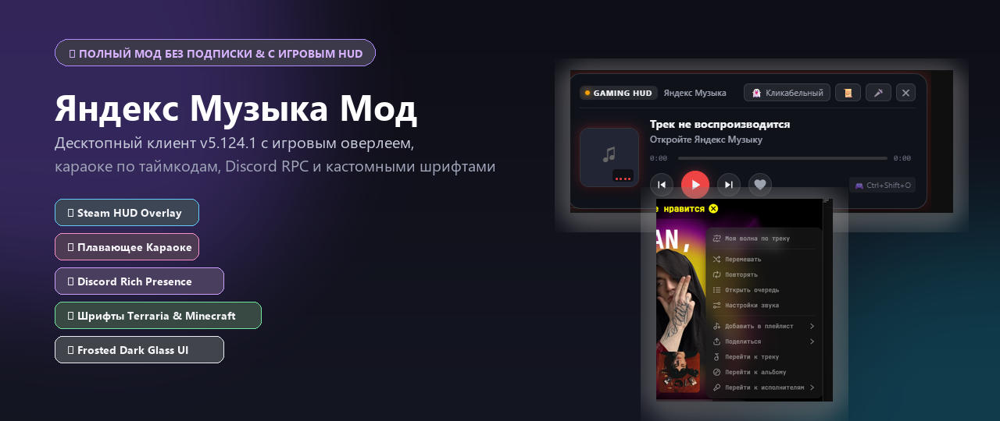
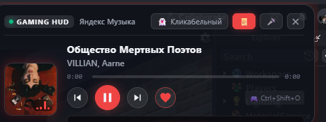
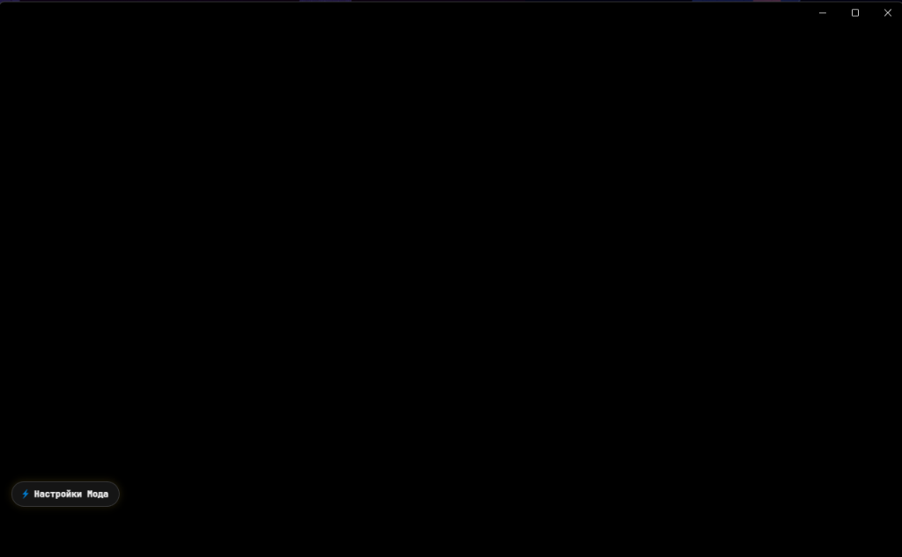
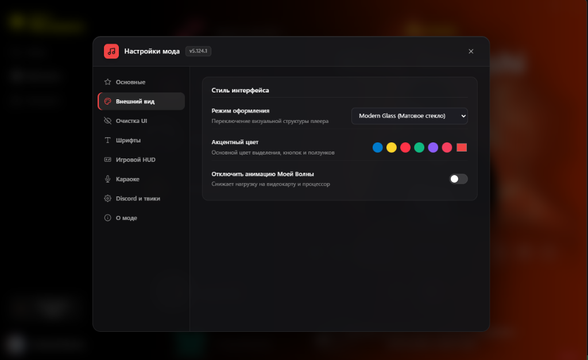
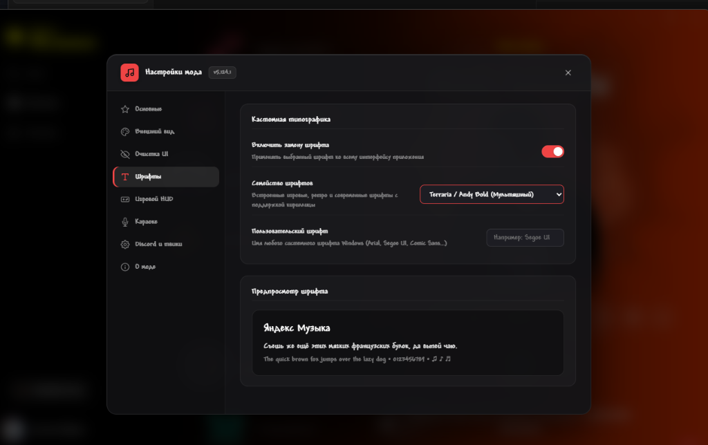

# 🎵 Яндекс Музыка — мод без Плюса

Набор модов для официального десктопного приложения **Яндекс Музыка (версия 5.124.1)**: игровой HUD-оверлей поверх всех окон, синхронные тексты песен (Караоке), Discord Rich Presence, кастомные геймерские шрифты и премиальный дизайн из матового темного стекла.

<p align="center">
  
</p>

<p align="center">
  <a href="https://github.com/alexis0eu/Mod-Yandex-Music/releases/latest">
    
  </a>
  
  
  
</p>

> [!TIP]
> **Работает в один клик через готовый `.exe`:** просто скачайте установщик из релизов, нажмите кнопку установки и наслаждайтесь любимой музыкой в играх без рекламы и ограничений!

---

## ❤️ Преимущества и возможности:

- ✔️ **Работает без подписки Плюс** — полноценное прослушивание треков и «Моей Волны».
- 🎮 **Игровой HUD-оверлей (`Ctrl + Shift + O`)**:
  - Компактный полупрозрачный плеер в стиле Steam / Discord прямо поверх любых игр (CS2, Dota 2, Minecraft, GTA V и др.).
  - **Сквозной режим Ghost Mode (`Ctrl + Shift + G`)**: клики мыши проходят сквозь плеер прямо в игру; при наведении на контролы кнопки активируются для управления.
  - Анимированный эквалайзер, обложка альбома с динамической подсветкой, плавная перемотка и кнопки переключения треков.
- 🎤 **Плавающее Караоке на экране (`Ctrl + Shift + L`)**:
  - Строка с текстом песни с подсветкой текущей активной фразы в реальном времени.
  - Встроенный резолвер: автоматически берет официальные синхронные таймкоды Яндекс Музыки с резервным поиском по мировой базе **LRCLib**.
- 💜 **Автономный Discord Rich Presence**:
  - Легковесный нативный IPC-клиент без сторонних модулей.
  - Показывает играющий трек, автора, обложку альбома, таймкод и кнопку быстрого прослушивания.
- 🔤 **Кастомные шрифты с 100% поддержкой кириллицы**:
  - `Terraria / Andy Bold` (мультяшный рукописный гейминг)
  - `Minecraft` (8-bit пиксельный ретро-стиль)
  - `Russo One` (плотный аркадный шрифт)
  - `Comfortaa` (плавный футуристичный скругленный)
  - `Unbounded` (техно / sci-fi / рейв)
  - `Caveat` (живой рукописный скетч)
  - `Podkova` (винтажный брусковый)
  - `JetBrains Mono` (терминальный моноширинный код)
  - Выбор любого системного шрифта Windows.
- 💎 **Премиальный матовый дизайн (Frosted Dark Glass)**:
  - Эстетика темного стекла с эффектом размытия фона (`backdrop-filter: blur(36px)`).
  - Никакого «нейрослопа» — аккуратные векторные SVG-иконки, удобные вкладки и предпросмотр шрифта на лету.
- 🎧 **Максимальное качество звука**:
  - Автоматический выбор максимального битрейта (320 kbps / FLAC Lossless).
- 👁️ **Блокировка рекламы и трекеров**:
  - Отключены аналитические метрики и рекламные модули.
- ⚙️ **Энергосбережение для игр**:
  - Возможность отключить тяжелую фоновую 3D-анимацию «Моя Волна» для максимального FPS.
- `</>` **Инструменты разработчика (`F12` / `Ctrl + Shift + I`)**:
  - Мгновенный вызов DevTools в любом окне клиента.

---

## 📸 Скриншоты мода

### 🎮 Игровой HUD-оверлей поверх игр и окон (`Ctrl + Shift + O`):
<p align="center">
  
</p>

### 🎤 Плавающее синхронное Караоке с подсветкой строк (`Ctrl + Shift + L`):
<p align="center">
  
</p>

### 💎 Меню настроек мода — Матовое темное стекло (Modern Glass):
<p align="center">
  
</p>

### 🔤 Кастомные шрифты (Terraria, Minecraft, JetBrains Mono и др.):
<p align="center">
  
</p>

---

## 💻 Как установить и пользоваться:

### Вариант 1 (Рекомендуемый — через готовый EXE в 1 клик):
1. **[Скачайте последнюю версию YandexMusicMod_Setup.exe](https://github.com/alexis0eu/Mod-Yandex-Music/releases/latest)** из вкладки Releases.
2. Запустите скачанный файл `YandexMusicMod_Setup.exe`.
3. Нажмите кнопку **«▶ Установить мод и запустить»** (или **«⬇ Скачать Яндекс Музыку и установить с модом»**, если приложение еще не установлено).
4. Программа сама всё сделает: если Яндекс Музыки нет на компьютере — автоматически загрузит и установит официальную версию 5.124.1, пропатчит файлы модом, настроит контрольные суммы и сразу запустит обновленную Яндекс Музыку!

*(Если потребуется вернуть стандартную версию Яндекс Музыки — в этом же окне нажмите «Оригинал (Откат)»).*

---

### Вариант 2 (Для разработчиков — из исходного кода):
Если у вас установлен Python:
```powershell
# Клонировать репозиторий
git clone https://github.com/alexis0eu/Mod-Yandex-Music.git
cd Mod-Yandex-Music

# Запустить скрипт внедрения мода
python tools/inject.py
```

---

## ⌨️ Горячие клавиши

| Хоткей | Действие |
| :--- | :--- |
| **`Ctrl + Shift + O`** | Открыть / свернуть Steam Gaming HUD Overlay |
| **`Ctrl + Shift + G`** | Включить / выключить сквозной режим кликов (Ghost mode) |
| **`Ctrl + Shift + L`** | Открыть / скрыть караоке с синхронным текстом песни |
| **`F12`** / **`Ctrl + Shift + I`** | Открыть инструменты разработчика (DevTools) |

---

## 📁 Структура репозитория

```
├── assets/                  # Скриншоты, баннер и иконка проекта
├── src/
│   ├── main/                # Electron Main: IPC-мосты, Discord RPC, LRCLib резолвер
│   ├── preload/             # Безопасные Preload-контексты для окон
│   ├── renderer/            # Меню мода, перехват экспериментов, матовые стили
│   ├── overlay/             # Игровой HUD-плеер (HTML / CSS / JS)
│   ├── karaoke/             # Плавающее окно караоке
│   └── fonts/               # Встроенные WOFF2 шрифты с кириллицей
├── tools/
│   ├── installer.py         # Исходный код единого графического установщика
│   ├── inject.py            # CLI-инжектор мода в app.asar
│   ├── restore.py           # Восстановление чистой оригинальной версии
│   ├── asar_tool.py         # Высокоскоростной упаковщик архивов Electron
│   └── verify.py            # Автоматические тесты целостности
└── README.md
```

---

## ⚠️ Отказ от ответственности (Disclaimer)
Этот проект создан исключительно в образовательных целях для изучения архитектуры приложений на базе Electron и протоколов IPC. Все права на торговую марку «Яндекс Музыка» принадлежат компании ООО «Яндекс».
